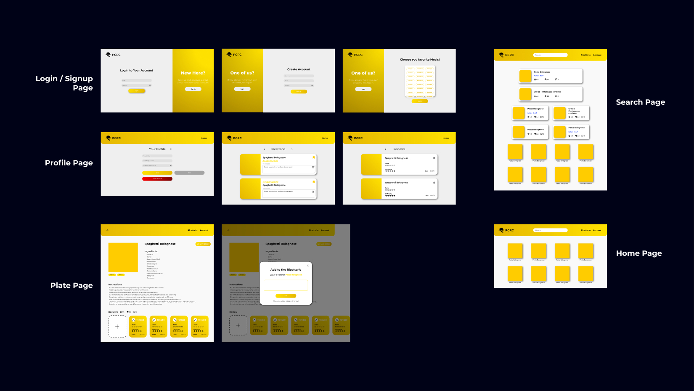

# PGRC — Recipe Management Platform

PGRC is a responsive recipe web application developed as an individual project for the Web and Cloud Applications course at the University of Milan (A.Y. 2023/2024). It uses TheMealDB REST API to retrieve recipes and lets users save dishes to a personal cookbook, add private notes, and write reviews.

## Features

- **Browse recipes:** discover random recipes or get suggestions based on selected cuisines and meal categories.
- **Search:** find recipes by name, first letter, or ingredient.
- **Recipe details:** view ingredients and quantities, preparation instructions, tags, and user reviews.
- **Personal cookbook:** save recipes, add private notes, edit those notes, and remove saved dishes.
- **Reviews:** rate taste and difficulty from 1 to 5, add the preparation date, and manage your own reviews.
- **Account management:** sign up, log in, update account details, and delete an account.
- **Responsive layout:** pages adapt to desktop and mobile screens.
- **Demo data:** load sample users, saved recipes, and reviews to try the main flows.

## Tech stack

- **Frontend:** HTML5, CSS3, vanilla JavaScript
- **UI:** Bootstrap 5.3.3, Google Fonts, Material Symbols
- **Recipe data:** [TheMealDB REST API](https://www.themealdb.com/api.php)
- **Browser storage:** `localStorage` for account data, saved recipes, and reviews; `sessionStorage` for the active session
- **Password hashing:** CryptoJS SHA-256, performed client-side

## Interface design

The interface was first planned in Figma before being implemented in HTML, CSS, and JavaScript.



The page navigation is documented in the [navigation schema](docs/navigation-schema.png).

## Project structure

```text
.
├── README.md
├── index.html
├── css/
│   ├── home.css
│   ├── login.css
│   ├── plate.css
│   ├── profile.css
│   ├── search.css
│   └── signup.css
├── html/
│   ├── home.html
│   ├── login.html
│   ├── plate.html
│   ├── profile.html
│   ├── search.html
│   └── signup.html
├── img/
│   ├── burger-menu.png
│   └── logo.png
├── js/
│   ├── api.js
│   ├── authentication.js
│   ├── data.js
│   ├── home.js
│   ├── plate.js
│   ├── profile.js
│   ├── search.js
│   └── utility.js
├── docs/
│   ├── ui-design.png
│   └── navigation-schema.png
└── video/
    └── success.mp4
```

## Running locally

The project does not require a build step or package installation. Python 3 can be used to serve the static files locally.

```bash
python -m http.server 8000
```

Then open [http://localhost:8000/html/home.html](http://localhost:8000/html/home.html) in your browser.

An internet connection is required to retrieve recipes from TheMealDB and load the external CSS, fonts, and JavaScript libraries.

## Storage notes

PGRC is a frontend-only coursework project and does not have its own backend or remote database. Recipe data comes from TheMealDB; accounts, preferences, saved recipes, private notes, and reviews are stored in the current browser. They are not shared across devices or between different users' browsers. The client-side login and password hashing are intended for this project demo, not for production authentication.

The **Load Demo Data** button on the Home and Search pages populates browser storage with sample data. It clears the current `localStorage` before loading the demo, so use it only if you are happy to replace existing local data. **Delete Data** clears `localStorage` and `sessionStorage` for the current origin.

## Project context

This was an individual project for the Web and Cloud Applications course at the University of Milan (A.Y. 2023/2024). It gave me practical experience with responsive web interfaces, REST API requests, JSON data, form validation, and client-side state management.
